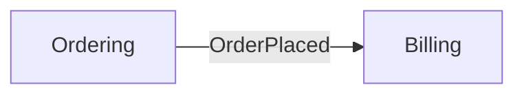
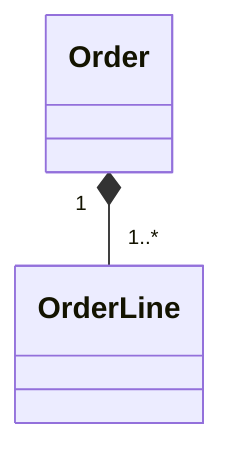
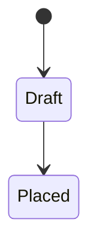

# MODEL.md Format

The model is the DDD domain model of the luminus applications. It lives at `/Users/othnielvisky/IO_obsidian/luminus/MODEL.md`. It grows one area at a time, so sections can be empty or incomplete for a long while. That's expected.

## Structure

No H1: Obsidian shows the file name as the title.

````md
## Context map

How the bounded contexts relate: who is upstream and downstream, and how they translate between each other (shared kernel, customer/supplier, conformist, anticorruption layer, ...).



- **Ordering → Billing**: {relation, and how terms are translated, e.g. "[[GLOSSARY#Customer]] becomes [[GLOSSARY#Customer (Billing)]]"}

## {Bounded context}

{What the context is responsible for, and which applications implement it, e.g. OCO UI, OCO service.}

### {Aggregate, e.g. Order}

{What it is, what it is responsible for, and the rules it must keep (invariants).}

- **Entities / value objects:** {the parts that belong to it}
- **Domain events:** {what it emits, and when}
- **Per application:** {how applications differ for this concept, if they do}
- **In code:** {where it lives, e.g. `oco-service/src/order/`}





### Flows

Key flows across aggregates or contexts, as `sequenceDiagram`s, each with a short description.

## Open questions

- {Concepts or relations that are not settled yet, with options and file paths.}

## Coverage

- **{Area}** ({date}): {what was modelled; what is still open}
````

## Rules

- **Use glossary terms only.** Every name in the text and the diagrams must be a glossary term. If a concept has no term yet, settle the term first. Link terms to the glossary on first use in a section, e.g. `[[GLOSSARY#Order]]`.
- **Text first, diagrams to support.** Each diagram needs a sentence or two saying what it shows. Add a diagram only when it makes things clearer than text:
  - `flowchart`: context map
  - `classDiagram`: aggregates, entities, value objects and how they relate
  - `stateDiagram-v2`: lifecycle of an aggregate
  - `sequenceDiagram`: flows across aggregates or contexts
- **Keep diagrams small.** One concern per diagram. Split rather than grow.
- **Model, not design.** Describe concepts, rules and relations. Point to code with "In code", but leave out classes, endpoints, tables and frameworks.
- **Mark unconfirmed facts** as `(inferred)` until the user confirms them.
- **Update in place.** When the model changes, rewrite the section. The history is in the ADRs, not in the model.
